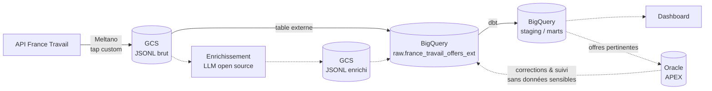

# Observatoire du marché de l'emploi & outil de suivi de recherche

> Pipeline de données de bout en bout sur les offres d'emploi, enrichies par un LLM open source, transformées avec **dbt** sur **BigQuery**, et complétées par une application **Oracle APEX** de validation et de suivi de candidatures.

**Statut : 🚧 en construction** (voir [l'avancement](#avancement))

---

## Pourquoi ce projet

Ce projet a deux objectifs :

1. **Analyser le marché de l'emploi** (compétences demandées, salaires, télétravail, tendances par métier et par région) à partir de données réelles et à jour.
2. **M'outiller dans ma propre recherche d'emploi** : identifier les offres pertinentes pour mes profils, suivre mes candidatures et mesurer mon propre funnel (offres vues → candidatures → entretiens).

Je suis développeur PL/SQL avec 11 ans d'expérience, en transition vers l'**analytics engineering**. Le projet combine donc deux facettes : une plateforme de données moderne (ELT, dbt, tests, documentation) et une application Oracle APEX.

## Questions auxquelles le projet répond

- Quelles compétences sont les plus demandées pour un métier donné, et comment évoluent-elles dans le temps ?
- Quelles sont les fourchettes de salaire par métier, région et niveau d'expérience ?
- Quelle part des offres proposent du télétravail ?
- Quelles offres correspondent le mieux à mes profils (Analytics Engineer, PL/SQL / APEX) ?
- Quel est mon taux de conversion à chaque étape de ma recherche, et quels types d'offres donnent des retours ?

## Architecture



Traits pleins : flux en place. Pointillés : flux à venir (voir [l'avancement](#avancement)).

**Principes de conception**
- **Le brut n'est jamais réécrit** : chaque exécution écrit dans un nouveau chemin, ce qui permet de rejouer les étapes en aval. Le bucket `raw` est la seule copie du brut et expire après 7 jours en dev, 30 en prod : au-delà, seul le snapshot dbt garde l'historique des offres.
- **BigQuery est la source analytique, Oracle est propriétaire des corrections humaines et du suivi de candidatures.** Un seul système de vérité par type de donnée.
- **Deux environnements isolés** (dev et prod), un projet GCP chacun, mêmes définitions de code, configuration différente.
- **Rien de sensible dans le dépôt, données personnelles cantonnées** : les coordonnées de contact publiées par France Travail (nom de recruteur, e-mail, téléphone) sont conservées dans le brut et extraites en staging pour mon usage personnel, mais exclues dès la couche intermédiaire, donc des marts et de toute vue publique ; mes propres contacts et notes restent dans Oracle.

## Stack technique

| Couche | Outil |
|---|---|
| Extraction | Meltano (tap Singer développé pour l'API France Travail) |
| Stockage brut | Google Cloud Storage (JSONL) |
| Enrichissement | LLM open source exécuté en local (Ollama ou llama.cpp), sorties structurées validées par schéma *(à venir)* |
| Entrepôt | BigQuery (région `europe-west1`) |
| Transformation | dbt (moteur Fusion) |
| Application | Oracle Autonomous Database + APEX, PL/SQL *(à venir)* |
| Infrastructure | Terraform |
| CI/CD | GitHub Actions, authentification GCP sans clé (Workload Identity Federation) |
| Orchestration | Airflow *(à venir)* |

## Environnements et infrastructure

Deux environnements isolés, **un projet GCP chacun**. Le code est identique, seules les valeurs changent (projet, rétention, garde-fous).

| Aspect | dev | prod |
|---|---|---|
| Rôle | bac à sable jetable, périmètre réduit | données réelles, déploiement sur approbation |
| Rétention du brut | 7 jours | 30 jours |
| Destruction des buckets `raw` et `enriched` | autorisée (`force_destroy`) | non |
| Suppression de la table externe `raw.france_travail_offers_ext` par Terraform | autorisée | bloquée (`deletion_protection`) |
| Déploiement de `envs/` (plateforme) | automatique, à chaque merge sur `main` qui touche `envs/dev` ou `modules/` (`terraform-dev.yml`) | à la promotion d'une release, après approbation, branche `main` uniquement (`terraform-prod.yml`) |
| Déploiement de `identity/` (WIF, garde-fous de coût) | à la main, en local | à la main, en local |

Ce qui est créé dans chaque projet, par couche :
- **`infra/bootstrap/bootstrap.sh`**, une seule fois (hors Terraform) : le projet, l'activation des API et le bucket `tfstate` qui porte le state Terraform ;
- **`infra/envs/<env>`** (module `data_platform`), appliqué par la CI :
  - 3 buckets GCS : `raw` (brut, un chemin par run, expiré après la rétention), `enriched` (sorties du LLM, encore vide) et `meltano-state` (state Meltano, versionné) ;
  - le dataset BigQuery `raw` (avec la table externe sur le bucket `raw`), et en prod ceux des couches dbt (`staging`, `intermediate`, `marts`, `snapshots`) ; en dev et en CI, dbt crée lui-même son dataset unique ;
  - 3 service accounts au moindre privilège : `sa-extract`, `sa-dbt`, `sa-enrich`, et leurs droits sur ces buckets et datasets ;
- **`infra/identity/<env>`**, appliqué à la main :
  - un service account de déploiement `sa-deployer` et un pool Workload Identity Federation, limités à ce dépôt, à des GitHub Environments précis et, en prod, à la branche `main` (module `github_wif`) ;
  - une alerte de budget mensuel et un quota BigQuery quotidien sur les octets facturés (module `cost_guardrails`).

**Aucune clé JSON** n'existe : en local, j'agis par impersonation de service accounts ; depuis GitHub Actions, l'accès passe par Workload Identity Federation.

### Reproduire la mise en place

Prérequis : un compte GCP avec facturation, `gcloud`, Terraform 1.6 ou plus.

```bash
# 1. Projets, APIs et buckets de state (une seule fois)
export PROJECT_PREFIX="jobboard" SUFFIX="<suffixe-aléatoire>" BILLING_ACCOUNT="<id-facturation>"
./infra/bootstrap/bootstrap.sh

# 2. Plateforme, d'abord en dev
export TF_VAR_user_email="<ton-adresse>"
gcloud auth application-default set-quota-project jobboard-dev-<suffixe>
cd infra/envs/dev && terraform init && terraform plan && terraform apply

# 3. Identités pour la CI (Workload Identity Federation) et garde-fous de coût
export TF_VAR_billing_account="<id-facturation>"
cd ../../identity/dev && terraform init && terraform plan && terraform apply
```

Répéter ensuite pour la prod, en changeant le *quota project* de `gcloud` avant chaque environnement.

## Extraction (Meltano)

Un tap Singer développé pour l'API France Travail (authentification OAuth2, pagination, filtrage par mots-clés/région) alimente un run Meltano complet, en **full-refresh** à chaque exécution plutôt qu'en incrémental : l'API ne signale jamais les offres qui disparaissent, donc chaque run donne l'ensemble exact des offres actives à cet instant, ce qui permettra à dbt de déduire en aval quelles offres ont fermé depuis le run précédent.

**Ce que produit un run :**
```
gs://jobboard-<env>-3b375b-raw/france-travail/offers/ingested_at=<INGESTED_AT>/part-<timestamp>.jsonl
gs://jobboard-<env>-3b375b-raw/france-travail/offers/ingested_at=<INGESTED_AT>/_SUCCESS
```

`_SUCCESS`, fichier vide, est écrit par `run.sh` une fois le run Meltano réussi : un dossier sans ce fichier (extraction en échec ou en cours) est un run incomplet, à ne pas charger.

Chaque enregistrement contient `id`, `dateActualisation`, `_raw` (le payload complet de l'offre, sérialisé en JSON texte), `_extracted_at` et `_ingested_at`.

**Lancer une extraction :**
```bash
export MELTANO_ENVIRONMENT=dev   # ou prod
export GCP_PROJECT_ID="jobboard-${MELTANO_ENVIRONMENT}-3b375b"
export INGESTED_AT=$(date -u +%Y%m%dT%H%M%SZ)

cd extraction
uv sync --frozen && source .venv/bin/activate     # Python et Meltano aux versions figées
meltano --environment="$MELTANO_ENVIRONMENT" install
./run.sh
```

`run.sh` pointe le state Meltano vers le bucket GCS de l'environnement choisi, puis lance `tap-francetravail` → `target-gcs`. Aucune clé n'est nécessaire : l'authentification GCP passe par l'impersonation de `sa-extract` en local, et par Workload Identity Federation une fois exécuté depuis GitHub Actions.

**Décisions prises en cours de route, documentées dans les choix techniques ci-dessous :** `_raw` stocké en chaîne plutôt qu'en objet imbriqué (contourne un bug de sérialisation du target), un seul identifiant de run (`INGESTED_AT`), généré une fois par l'appelant.

## Chargement (GCS → snapshot dbt)

Le brut n'est pas copié dans BigQuery : la table externe `raw.france_travail_offers_ext` (Terraform) lit les fichiers en place dans GCS, partitionnés par run sur la clé Hive `ingested_at`. `loading/load.py` fait entrer les runs dans l'historique :

1. dernier run traité = plus grande borne du snapshot dbt ;
2. runs à traiter = dossiers qui contiennent `_SUCCESS`, postérieurs à ce marqueur, du plus ancien au plus récent ;
3. pour chaque run : garde-fou de volume, puis `dbt snapshot --vars '{ingested_at: <run>}'` ; le premier échec arrête la boucle ;
4. `dbt build` des modèles en aval du snapshot.

```bash
cd loading && GCP_PROJECT_ID=jobboard-dev-3b375b uv run load.py
```

Il ne dépend pas d'`INGESTED_AT` : il rattrape tous les runs terminés en attente. Le target dbt suit le profil (`dev` par défaut, `DBT_TARGET` pour un autre).

**Pipeline complet, orchestré par un unique workflow GitHub Actions planifié** (`.github/workflows/pipeline-france-travail.yml`), une fois par jour : job `extract` (génération de l'identifiant de run, extraction, avec `sa-extract`), puis job `load` (`load.py`, avec `sa-dbt`), lancé même si la collecte échoue pour rattraper les runs en attente. Pour l'instant, le job `load` est sauté sur le lancement planifié : seule la collecte tourne chaque jour, et le chargement se lance à la main (`-f load_only=true`), qui rattrape tous les runs terminés en attente.

**Version exécutée en prod :** le pipeline de prod n'exécute pas le dernier commit de `main`, mais la release (tag `vX.Y.Z`) désignée par `deploy/prod-version`, modifié par PR. Publication d'une release, promotion et retour arrière : [deploy/README.md](deploy/README.md).

## Avancement

- [x] Projets GCP dev et prod, bucket de state Terraform (script de bootstrap)
- [x] Plateforme dev en Terraform (buckets, dataset BigQuery `raw`, service accounts, IAM)
- [X] Plateforme prod en Terraform
- [x] Workload Identity Federation pour GitHub Actions (dev puis prod)
- [x] Tap Meltano France Travail (développement, tests, `ruff`, `mypy`)
- [x] Extraction France Travail → GCS (Meltano), state distant, run.sh
- [X] Workflow GitHub Actions planifié (collecte quotidienne)
- [x] Brut lu en place dans GCS (table externe), runs choisis et contrôlés par `loading/load.py` avant le snapshot
- [ ] Modélisation dbt (staging, marts) et tests *(en cours : snapshot SCD2, staging, `int_offers`, `fct_offers`, `dim_date` ; schéma en étoile cible conçu dans `docs/offers_star_schema.md`, règles fondées sur le profilage du brut)*
- [ ] Premier dashboard
- [x] Protection de `main` et paramètres GitHub versionnés, contrôlés par `.github/settings/check.sh`
- [x] Releases (tags `vX.Y.Z` protégés) et promotion explicite de la version de prod (`deploy/prod-version`)
- [ ] CI/CD (lint, plan Terraform, dbt sur pull request) *(en cours : validation statique sur pull request, checks obligatoires sur `main`, build dbt des modèles modifiés dans `pr_<n>`, plan Terraform de dev sur pull request, apply Terraform de dev au merge et de prod à la promotion d'une release)*
- [ ] Score de pertinence par règles
- [ ] Application APEX v1 (offres pertinentes, suivi de candidatures)
- [ ] Enrichissement LLM et jeu d'évaluation
- [ ] Synchronisation BigQuery ⇄ Oracle, funnel personnel
- [ ] Orchestration

## Données et conformité

- Source : API *Offres d'emploi* de France Travail, utilisée dans le respect de ses conditions d'utilisation.

## Structure du dépôt

```
infra/          Terraform : bootstrap, modules, envs/ (plateforme) et identity/ (CI), en dev et prod ;
                github/ : rulesets et paramètres du dépôt GitHub
extraction/     Projet Meltano, tap France Travail, run.sh (point d'entrée de l'extraction)
loading/        Chargement des runs terminés dans le snapshot dbt (load.py)
transformation/ Projet dbt (snapshot, staging, intermediate, marts)
deploy/         Version de prod (prod-version) et son contrôle (resolve-prod-ref.sh)
docs/           Documents de conception (schéma en étoile des offres), profilage des sources
enrichment/     Enrichissement LLM (à venir)
oracle/         Migrations, packages PL/SQL, application APEX, données fictives (à venir)
orchestration/  Orchestration Airflow (à venir)
.github/        Workflows CI/CD
.continue/      Règles des assistants IA (partagées avec Claude Code) et agent Continue local
```

## Choix techniques et compromis

| Choix | Raison | Alternative écartée |
|---|---|---|
| Un projet GCP par environnement | isolation simple et sûre des données et des droits | un seul projet avec des préfixes |
| Deux environnements (dev, prod) | projet à un seul utilisateur ; des datasets éphémères par pull request et l'approbation de la prod jouent le rôle d'un environnement de test | un troisième environnement de recette |
| Identifiants de projet avec suffixe aléatoire | unicité mondiale exigée par GCP, sans information personnelle | un suffixe lié à mon identité |
| Région unique `europe-west1` | dans l'UE, coût inférieur à la multi-région et à Paris | multi-région `EU`, région américaine (quota gratuit GCS plus large mais moins cohérent avec le RGPD) |
| Terraform avec state distant dans GCS | état partagé entre mon poste et la CI | state local |
| Bucket de state versionné (activé par `bootstrap.sh`) | filet de sécurité quasi gratuit pour un fichier de quelques Ko : un state corrompu ou écrasé se restaure | bucket sans versioning |
| `identity/` séparé de `envs/` | la CI ne peut pas modifier sa propre porte d'entrée, et détruire le dev n'entraîne pas la perte du pool WIF | tout dans un seul state |
| Impersonation et Workload Identity Federation | aucune clé JSON à stocker ou à faire tourner, jetons de courte durée | clés de service accounts |
| Branche `main` imposée côté GCP en prod (`attribute_condition` du provider WIF), en plus de la règle de branche des GitHub Environments | défense en profondeur : si la règle GitHub est retirée ou mal configurée, un job lancé depuis une autre branche reste refusé par GCP dès l'échange de token. Le filtre est porté par le provider plutôt que par les bindings, car chaque environnement a son propre pool : une seule condition, sans nouveau mapping d'attribut. Le dev reste ouvert à toutes les branches pour valider un workflow avant le merge | seule la règle de branche de GitHub, filtre `attribute.ref` dans chaque binding `principalSet` |
| Un service account par usage | moindre privilège : l'extraction ne peut pas modifier les modèles, dbt ne peut pas écraser le brut | un compte unique |
| `sa-dbt` : `bigquery.user` sur le projet, droits sur les données accordés dataset par dataset (lecture sur `raw` et sur le bucket `raw`, écriture sur les couches de prod) | `bigquery.user` permet de lancer des requêtes et de créer un dataset sans accès aux données ; le créateur devient propriétaire de son dataset, ce qui suffit en dev (`analytics`) et en CI (`pr_<n>`). dbt ne peut donc ni modifier ni supprimer le brut | `dataEditor` sur le projet (écriture sur tous les datasets, dont `raw`) |
| `sa-deployer` administrateur de fait de son projet (`projectIamAdmin`, `serviceAccountAdmin` et `storage.admin` au niveau projet) | Terraform gère l'IAM du projet et des service accounts : un compte qui accorde des rôles peut se les accorder, et une restriction sur l'un de ces rôles se contourne par un autre. Le contrôle porte donc sur qui peut l'utiliser : WIF limité à ce dépôt et, en prod, à l'Environment `prod` avec approbation manuelle ; `identity/` reste hors de portée de la CI. Limite : la vraie barrière est cette approbation, pas le périmètre IAM | condition IAM limitant les rôles accordables (à étendre à `serviceAccountAdmin`, liste à mettre à jour à chaque nouveau rôle de `data_platform` puis à appliquer à la main dans `identity/prod`) |
| LLM exécuté en local | aucun coût GPU cloud, données non envoyées à un prestataire | Cloud Run avec GPU, Vertex AI |
| Filtre par mots-clés à l'API, une liste par environnement (réduite en dev) | volume limité et ciblé sur mes deux profils (Analytics Engineer, PL/SQL) ; la classification fine reste en aval. Limite : 3 150 résultats max par requête, une requête trop large fait échouer le run et doit être découpée | extraction de tout le domaine informatique (élargissable plus tard) |
| Échec du run dès qu'une requête dépasse 3 150 résultats (total lu dans `Content-Range`) | une requête tronquée fausserait le snapshot dbt (offres non lues marquées closes) ; mieux vaut une journée de collecte perdue, visible et rattrapable, qu'un résultat partiel silencieux | avertissement dans les logs et lecture jusqu'à l'index 3149 (troncature invisible tant que le run est vert) |
| Pas de Secret Manager au départ | limiter la surface et les coûts ; les secrets sont dans les GitHub Environments | Secret Manager (à activer si le besoin apparaît) |
| GitHub Actions planifié avant Airflow | suffisant pour une collecte quotidienne, sans infrastructure | Cloud Composer (coût élevé pour ce volume) |
| Extraction en full-refresh, sans incrémental | l'API ne signale pas les offres fermées ; seul un instantané complet à chaque run permet à dbt de déduire les fermetures | incrémental sur `dateActualisation` (aurait manqué les fermetures) |
| `_raw` sérialisé en chaîne JSON dans le tap | contourne un bug du target retenu (`Decimal` non sérialisable par sa bibliothèque JSON) sans en dépendre pour un correctif | forker le target pour corriger sa sérialisation (dette technique sur une dépendance à 2 étoiles, non maintenue) |
| Un seul identifiant de run (`INGESTED_AT`), généré une fois par l'appelant de `run.sh` | le chemin GCS et la colonne `_ingested_at` portent la même valeur, sans divergence possible (notamment autour de minuit) ; `run.sh` valide sa présence plutôt que de le calculer. Le chargement ne le reçoit pas : il retrouve les runs terminés par leur `_SUCCESS` | `run_id` et date calculés séparément dans chaque script, identifiant transmis au chargement (un run en échec ne serait jamais rattrapé) |
| `run.sh` et `load.py` comme points d'entrée uniques | même commande testée en local, appelée par le CI puis plus tard par Airflow, sans dupliquer la logique | commandes Meltano/bq écrites directement dans le YAML du workflow |
| `_raw` chargé en `STRING`, `PARSE_JSON` réservé à la couche staging dbt | BigQuery ne convertit pas une chaîne JSON-encodée en type `JSON` structuré au chargement ; garder `_raw` en chaîne évite de réintroduire le bug de sérialisation `Decimal` | déclarer `_raw` en type `JSON` (aucun gain sans objet non échappé en source) |
| `require_partition_filter` sur la table externe, clé Hive `ingested_at` ; freshness de la source et tests de source filtrés sur les 7 derniers jours | le brut croît d'un instantané complet par run : une requête qui oublie le filtre lirait tous les fichiers du bucket. L'option rend ce scan impossible au lieu de compter sur la discipline. Seule la clé Hive élague : un filtre sur `_ingested_at` est rejeté | pas d'option (tests de source sur tout le bucket à chaque build) |
| Brut lu en place dans GCS par une table externe (partitionnement Hive sur `ingested_at`, filtre de partition obligatoire) | le brut n'est plus stocké deux fois, et il n'y a plus de chargement à orchestrer. Limite assumée : GCS devient la seule copie, un run n'est rejouable que pendant la rétention du bucket (7 jours en dev, 30 en prod) | table native chargée par `bq load` (double stockage), rétention allongée (perte au-delà de 30 jours acceptable pour ce projet) |
| Choix des runs à snapshoter dans `loading/load.py`, hors de dbt : runs terminés (`_SUCCESS` écrit par `run.sh`) postérieurs à la plus grande borne du snapshot, traités un par un dans l'ordre, arrêt au premier échec | logique d'orchestration lisible et testée en Python, au lieu d'une macro Jinja appelée trois fois par run. Le marqueur est déduit du snapshot lui-même : pas de table d'état à maintenir. Un run sans aucun changement ne l'avance pas et est rejoué sans effet | macro dbt qui choisit le jour et marqueur dans une table `meta.state_snapshot` avancé par un `post_hook`, supprimés avec l'issue #85 |
| Garde-fou de volume dans `loading/load.py`, avant chaque `dbt snapshot` : run vide refusé, nombre d'offres comparé aux versions ouvertes du snapshot (`--min-volume-ratio`, 0,8) | `hard_deletes: invalidate` clôt toute offre absente de la source : un run vide ou partiel fermerait à tort des milliers d'offres dans un historique irremplaçable. La référence (versions ouvertes) ne lit que la partition `NULL` du snapshot, et le ratio suit le volume du marché sans réglage | test dbt de volume sur la source (non exécuté par `dbt snapshot`), `dbt run-operation` (logique Jinja), seuil absolu (à réajuster quand le marché ou `search_queries` évolue) |
| Snapshot en stratégie `check` sur `dateActualisation`, toutes ses bornes datées au jour d'ingestion traité (surcharge de `snapshot_get_time`) | une seule horloge, croissante d'un run à l'autre : les marqueurs incrémentaux de `stg_` et `fct_offers` restent fiables, une offre rouverte ne chevauche pas sa clôture, et une clôture porte le jour d'ingestion même en rattrapage. Une version est créée dès que `dateActualisation` change, même si elle recule | stratégie `timestamp` (versions datées par la source : versions perdues par les marqueurs, périodes qui se chevauchent), périodes recalculées dans un staging reconstruit à chaque run (`_raw` relu en entier, perte de l'incrémental) |
| `fct_offers` sous contrat (`contract: enforced`) avec liste de colonnes explicite, en gardant `on_schema_change='append_new_columns'` | le schéma du mart est décidé dans son YAML : une colonne ajoutée dans `int_offers` n'y entre pas sans modification du SQL et du contrat, et le build échoue sur un écart de type ou de nom. `append_new_columns` permet ensuite d'ajouter au mart une colonne déclarée sans le reconstruire | `SELECT *` sans contrat (schéma modifié en silence), `on_schema_change='fail'` (chaque ajout de colonne imposerait un `--full-refresh`) |
| `stg_france_travail__offers` et `fct_offers` partitionnés par mois sur `_valid_to`, cible du `merge` restreinte à `_valid_to IS NULL` (`incremental_predicates`) | le `merge` n'insère que des versions nouvelles et ne met à jour que des versions encore ouvertes (fermetures) : il ne lit que la partition des offres actives, et son coût ne croît plus avec l'historique. Une fermeture déplace la ligne dans la partition de son mois. Les lectures des offres actives n'ouvrent qu'une partition | partition sur `_valid_from` (une fermeture d'offre ancienne sort de toute fenêtre de filtre et devient un doublon ; sans filtre, la cible est lue en entier), `insert_overwrite` (la source ne contient que les lignes modifiées : réécrire une partition effacerait les autres), partition par jour (partitions de quelques Ko) |
| Snapshot partitionné par mois sur `dbt_valid_to`, marqueurs de `stg_` lus par `run_query` et injectés en littéraux | la comparaison du snapshot ne porte que sur les versions ouvertes, et `stg_` ne lit plus que celles-ci et le mois en cours : le coût suit le stock d'offres actives, plus l'historique de `_raw`. Une sous-requête dans le filtre empêche l'élagage. Le `MERGE` du snapshot élague aussi, via la surcharge `bigquery__snapshot_merge_sql` qui place le filtre dans le `ON` (code interne de Fusion, à revérifier à chaque mise à jour). Migration par copie : partitionnement impossible sur une table existante, contenu identique sans rejeu | sous-requête sur `{{ this }}` (snapshot lu en entier à chaque run), partition par jour (élagage plus fin, partitions minuscules, incohérent avec `stg_`), migration par rejeu jour par jour (dépend de la rétention du brut, un run par jour) |
| Coordonnées de contact gardées en staging, exclues à partir de `int_offers` | utiles pour postuler (usage personnel), sans fuite vers les marts ou un dashboard public | masquage dès l'extraction (perte d'une information utile) |
| Collecte et chargement dans un même workflow, en deux jobs (`extract` avec `sa-extract` dans `prod-collect`, `load` avec `sa-dbt` dans `prod-load`) ; `load` tourne aussi après une collecte en échec | l'environnement du chargement se déduit des mêmes `inputs` que la collecte : une collecte dev ne peut pas déclencher un chargement prod. Chaque job a son runner, son environnement et son compte (moindre privilège). Le workflow se valide en dev depuis une branche avant le merge. `load_only` relance le chargement seul | workflow de chargement séparé déclenché par `workflow_run` (environnement de la collecte inconnu, chargement limité aux collectes planifiées, validation impossible avant le premier merge), chargement dans le même job (un seul compte avec les droits des deux) |
| Toutes les dépendances de la collecte figées : Python et Meltano par `uv.lock`, plugins par SHA ou version exacte dans `pip_url`, leurs dépendances transitives par un fichier de contraintes (`extraction/constraints/`), `dbt_utils` en version exacte | la collecte de prod tourne seule chaque jour avec accès à GCS et BigQuery : une version publiée en amont (casse ou paquet compromis) ne doit pas l'atteindre sans passer par une PR. Coût : régénérer locks et contraintes à chaque montée de version | versions flottantes ou plages (casse possible sans changement du dépôt), figer le seul niveau direct (dépendances transitives toujours flottantes) |
| Collectes sérialisées dans un groupe `concurrency` unique, tous environnements et branches confondus, avec `cancel-in-progress: false` et `queue: max` | dev et prod partagent une seule clé d'API France Travail, donc un même quota. Un run en attente démarre après le précédent au lieu de l'interrompre : annuler une collecte peut laisser des fichiers partiels dans GCS ou un state Meltano à moitié écrit. Limite : un run dev lancé vers 05:00 UTC retarde la collecte de prod | un groupe par environnement (deux runs simultanés sur la même clé), annulation du run en cours |
| Rulesets et paramètres GitHub versionnés en JSON (`.github/settings/`), appliqués à la main, dérive détectée par `check.sh` | les règles Git et GitHub ne reposent plus sur la discipline : un push direct sur `main` est refusé, même pour l'administrateur (bypass vide). Les rulesets se cumulent, s'appliquent aussi aux tags et s'exportent en JSON. Comme `identity/prod`, la configuration reste hors de portée de la CI et de l'agent. Limite : la dérive n'est vue que si `check.sh` est lancé | provider Terraform `integrations/github` (token d'administration sur le poste et un state de plus, pour un seul dépôt), branch protection classique (ni tags ni cumul), configuration dans l'interface seule (ni trace ni contrôle), fichiers sous `infra/` (mêlés au Terraform et à son périmètre de règles ; une gestion par Terraform les y ramènerait) |
| CI de pull request statique, sans credentials GCP ni filtre `paths`, tous les jobs à chaque PR | lint, typage, tests Python, `terraform validate` et `dbt parse`/`lint`/`format` n'ont besoin ni de GCP ni de secret : la CI ne coûte rien et ne peut rien exposer. Ses jobs sont des checks obligatoires de `main` ; un workflow filtré par `paths` ne se déclencherait pas et bloquerait la PR. Une PR dbt lance donc aussi les tests Python, en parallèle (une à deux minutes, gratuites sur un dépôt public) | jobs conditionnés par un calcul des chemins modifiés (filtres à maintenir, une omission laisse passer une PR sans validation : à reconsidérer pour les jobs coûteux, #104 et #105) |
| Build dbt des PR en slim CI : modèles modifiés et descendants (`state:modified+`) construits dans `pr_<n>` du projet de dev, le reste lu dans `analytics` (`--defer`), snapshots exclus, dataset supprimé à la fermeture de la PR (`transformation/ci/pr.sh`, `dbt-pr.yml`) | une erreur SQL, un test en échec ou une violation de contrat apparaît avant le merge, pour le coût de quelques requêtes (120 Mio facturés pour `int_offers` et `fct_offers`, surtout le minimum de 10 Mio par requête). Le manifest de référence est produit à chaque run par un `dbt parse --target dev` du commit de base : aucun artefact à conserver. Les snapshots restent lus dans `analytics` : reconstruits sur un seul run, leur historique serait artificiel. Coût lu dans `INFORMATION_SCHEMA.JOBS_BY_USER` par les `job_id` de `run_results.json`, Fusion n'y renseignant pas les octets. Limites : le résultat dépend de l'état d'`analytics` en dev (objets d'une autre branche ou absents) ; une modification du snapshot se valide à la main en dev ; si la suppression échoue, `pr_<n>` reste en place, sans expiration ; le code de la PR s'exécute avec `sa-dbt` de dev (dépôt à un seul contributeur, aucun jeton OIDC pour un fork). Workflow distinct de `ci.yml`, non obligatoire, donc filtrable par `paths` | build complet sur snapshot vide (modèles et tests sur zéro ligne), clone du snapshot de dev à chaque PR (copie et droits supplémentaires), manifest de `main` conservé en artefact (stockage et mise à jour à gérer), defer vers la prod (`sa-dbt` de dev n'y a aucun droit, volontairement) |
| Plan Terraform des PR sur `envs/dev` seulement, publié dans le résumé du job (`infra/ci/plan.sh`, `terraform-pr.yml`), avec `sa-deployer` de dev et `-lock=false` | l'effet réel d'une PR sur l'infra se voit en relecture, et non plus seulement par un plan local. Le code de `envs/dev` et `envs/prod` est identique : le plan dev montre l'effet des modules. `-lock=false` : un plan n'écrit pas le state, et un run annulé laisserait un verrou à lever par `force-unlock`. `TF_VAR_user_email` vient d'un secret de l'environment `dev`. Limites : les écarts propres à la prod (`var.env`, tfvars) ne sont pas vus avant la promotion ; un plan lancé pendant un apply local peut lire un state en cours d'écriture ; `identity/` n'est pas planifié (`sa-deployer` n'a pas le droit de lire le pool WIF, plan local par le propriétaire) ; le code de la PR s'exécute avec `sa-deployer` de dev, administrateur de fait d'un projet jetable (dépôt à un seul contributeur, aucun jeton OIDC pour un fork). Workflow non obligatoire, donc filtrable par `paths` | plan prod sur PR (WIF de prod limité à `main`, et un `sa-planner` prod lirait le state de prod depuis du code non relu), plan publié en commentaire de PR (`pull-requests: write`), job dans `ci.yml` (credentials dans la CI statique, check obligatoire) |
| Code de prod promu par release : tag annoté `vX.Y.Z` protégé (ruleset `release-tags`), désigné par `deploy/prod-version` modifié par PR ; le workflow reste déclenché depuis `main` et fait son checkout sur le commit du tag, vérifié par `deploy/resolve-prod-ref.sh` (ancêtre de `main`) | merger n'est plus déployer : la mise en prod est un choix explicite et tracé, le retour arrière un `git revert` de la promotion. Déclencher depuis `main` garde valides les environments `prod-*` et la condition WIF, limités à `main`. Le contrôle est lu depuis `main`, jamais depuis le tag ; les versions d'outils liées au code (`dbt-fusion.env`) suivent le tag. Limite : le YAML du workflow vient de `main` et doit rester compatible avec la version en prod | dernier commit de `main` (merge = déploiement), checkout automatique du dernier tag (créer un tag déploierait), version dans une variable des GitHub Environments (hors Git, dupliquée), déclenchement `push: tags` (condition WIF à modifier), workflow réutilisable épinglé au tag (à reconsidérer si la limite gêne) |
| Infrastructure de prod promue avec la release, pas au merge sur `main` : `terraform-prod.yml` applique `envs/prod` au commit du tag au merge d'une modification de `deploy/prod-version` ; `terraform-dev.yml` applique `envs/dev` à chaque merge qui touche l'infra | le code de prod est figé sur un tag : un `apply` prod à chaque merge désynchroniserait l'infra de ce code (exemple : suppression du dataset `meta` alors que le code de prod l'utilise encore, #95). Un seul point de promotion pour le code et l'infra ; un changement cassant se découpe en deux temps (expand/contract). Le dev suit `main`, sans approbation | `apply` prod au merge sur `main` (infra en avance sur le code de prod) |
| Plan et apply en deux jobs d'un workflow réutilisable (`terraform-apply.yml`) ; le job `apply` refait le plan et ne l'applique que si l'empreinte (sha256 de `terraform show`) est celle du plan publié ; en prod, deux approbations de l'environment `prod` | ce qui est appliqué est ce qui a été relu, sans transporter le fichier `tfplan` : il contient des valeurs sensibles en clair, et un artifact est téléchargeable par tout compte GitHub sur un dépôt public. Une dérive entre les deux jobs fait échouer l'apply au lieu de l'élargir. Le même chemin tourne en dev à chaque merge, alors que la prod ne se teste pas avant le merge (WIF limité à `main`). Limites : le plan de prod, qui a besoin de `sa-deployer`, demande lui aussi une approbation ; les valeurs sensibles, masquées dans `terraform show`, n'entrent pas dans l'empreinte ; le script lu dans le tag impose une release qui le contient | un seul job approuvé avant le plan (approbation sans lecture du plan prod), `tfplan` en artifact (fuite du state), `tfplan` chiffré (clé à gérer, pas de Secret Manager), `sa-planner` de prod en lecture seule dans un environment sans approbation (une approbation, mais un compte et un environment de plus dans `identity/prod`, à reconsidérer si les deux clics gênent) |
| Alerte de budget et quota BigQuery quotidien dans `identity/<env>` (module `cost_guardrails`), appliqués à la main, quota au niveau du projet | un garde-fou que la CI pourrait relever ne protège pas : dans `envs/`, `sa-deployer` aurait besoin de `roles/cloudquotas.admin` et d'un rôle sur le compte de facturation, qui dépasse le projet. Le budget ne fait qu'alerter ; le quota est le seul plafond qui bloque. Quota du projet plutôt que par utilisateur : il borne la somme de toutes les identités. Quand il est atteint, `load.py` échoue et rattrape les runs en attente au passage suivant ; la collecte vers GCS n'est pas touchée. Identifiant du compte de facturation dans `TF_VAR_billing_account`, jamais versionné (dépôt public) | budget créé dans la console (non vérifiable, constat de #34), budget et quota dans `envs/` (droits élargis pour `sa-deployer`), coupure automatique de la facturation par Pub/Sub et Cloud Function (arrête tout le projet, surdimensionné), quota par utilisateur (même valeur pour chaque identité, ne borne pas le total) |
| Règles des assistants IA dans `.continue/rules/`, `.claude/rules` en lien symbolique, `AGENTS.md` à la racine importé par `CLAUDE.md` | une seule source lue nativement par Claude Code et Continue (LLM local) ; chaque règle porte `paths:` et `globs:` pour n'être chargée que sur son périmètre | `uses:` dans l'agent Continue (chemins relatifs cassés par un bug de Continue), un CLAUDE.md par sous-dossier (ignoré par Continue) |
| `fct_offers` au grain de l'offre dans son dernier état, historique porté par le snapshot | les versions n'ont pas d'usage identifié ; le snapshot les conserve, et une fait au grain version reste possible sans perte | grain à la version, avec une vue sur la dernière version (dédoublonnage recalculé et facturé à chaque requête, risque de double comptage) |
| `dim_offers` en 1:1 avec `fct_offers`, la fait réduite aux clés, dates et mesures | dimension commune aux faits à venir (`fct_applications`, `fct_offer_matches`) : une fait ne pointe jamais vers une autre fait | attributs descriptifs dans la fait (une jointure de moins, mais pas de point d'entrée pour les autres faits) |
| Schéma en étoile sans snowflake : hiérarchies à plat (lieu, ROME, NAF, siège, maison mère), relations N:N par bridges rattachés à la fait | une jointure par axe d'analyse, lisible par les outils de BI ; le stockage en colonnes rend la redondance quasi gratuite | dimensions normalisées en cascade (ville → département → région), liens entre dimensions |
| Mart indépendant de la source : `offer_id` haché sur (source, identifiant d'origine), codes de chaque source traduits en valeurs communes en intermediate, nomenclatures publiques (ROME, INSEE, NAF) | d'autres sources d'offres suivront France Travail sans changer le mart | codes France Travail dans le mart (D/S/E, `MIS`…), identifiant d'origine comme clé |
| Profilage du brut de prod en DuckDB sur une copie locale (`docs/profiling/`), avant d'écrire les marts | règles du schéma en étoile vérifiées sur les données réelles, sans attendre la fin du staging ; dev a trop peu de données. Requêtes versionnées et rejouables, données hors du dépôt (contacts), valeurs personnelles masquées par défaut. Coût négligeable dans les deux cas (environ 120 Mo) | profilage du staging en BigQuery (staging inachevé, il mesurerait ses propres regex), copie de la prod en dev (données personnelles hors de la prod, isolation des environnements) |
| Clôture d'une offre après deux runs consécutifs d'absence, appliquée dans le mart | une absence d'un seul run est le plus souvent un trou de collecte (même run, date d'actualisation inchangée) : `closed_date` et la durée de publication restent justes. Le snapshot reste la trace brute | clôture dès la première absence (fausses clôtures), délai de grâce dans le snapshot (modifie la source d'historique) |
| Tables de marts au pluriel (`fct_offers`, `dim_companies`, `bridge_offers_skills`) | convention du guide dbt Labs, que suit le projet | singulier (convention Kimball) |

**Laissé de côté volontairement :** environnement de recette, orchestrateur managé, GPU cloud, Secret Manager.

**Garde-fous de coût :**

| Garde-fou | Valeur | Géré par |
|---|---|---|
| Alerte de budget mensuel, par projet (e-mail à 50, 90 et 100 % de la dépense, et à 100 % de la prévision) | `monthly_budget` dans `infra/identity/<env>/terraform.tfvars` | Terraform, `identity/` (module `cost_guardrails`), apply local |
| Quota BigQuery `QueryUsagePerDay` : octets facturés par jour pour tout le projet | `query_usage_per_day_mib` dans `infra/identity/<env>/terraform.tfvars` | Terraform, `identity/` (module `cost_guardrails`), apply local |
| Plafond `maximum_bytes_billed` par requête | 10 Go (dbt en dev et en prod, `loading/load.py`), 100 Mo (requêtes de `transformation/ci/pr.sh`) | `transformation/profiles.yml`, code |
| Rétention du brut | 7 jours en dev, 30 jours en prod | Terraform, `envs/` (module `data_platform`) |

**Coût mensuel constaté :** *à compléter après quelques semaines d'exploitation.*

## Auteur

Nicolas Fleurentin · [LinkedIn](https://www.linkedin.com/in/nicolasfleurentin/)
