# Schéma en étoile des offres

Document de conception du datamart des offres d'emploi, préalable à l'écriture des modèles dbt de `transformation/models/marts/`.

## Grain

`fct_offers` contient **une ligne par offre**, dans son dernier état connu. L'historique des versions n'est pas porté par le mart : il reste dans le snapshot dbt, dont sont dérivés les attributs d'historique (`closed_date`, `publication_duration_days`). Une analyse des changements d'une offre ferait l'objet d'une seconde table de faits, au grain de la version.

`fct_offers` ne garde que les clés, les dates et les mesures ; les attributs descriptifs de l'offre sont dans `dim_offers`, en 1:1 avec la fait, qui servira aussi de dimension commune à la future `fct_applications`. Les bridges restent rattachés à la fait et se joignent par `offer_id`, présent dans les deux tables.

`fct_offer_matches` contient une ligne par couple (offre, profil de recherche) : elle mesure la pertinence d'une offre pour chacun des profils cibles de `dim_profiles`.

## Conventions

- Tables au pluriel, selon le guide dbt Labs (`fct_offers`, `dim_companies`), y compris les bridges.
- Types BigQuery (`STRING`, `INT64`, `NUMERIC`, `BOOL`, `DATE`, `FLOAT64`).
- Les montants sont suffixés par leur devise (`_eur`, ISO 4217).
- Les clés `*_id` des dimensions sont des clés de substitution (hash des clés naturelles), sauf `dim_dates`, dont la clé est la date elle-même.
- Le modèle est indépendant de la source : France Travail est la première, d'autres suivront. Les codes et libellés propres à une source sont traduits en valeurs communes en intermediate ; le mart ne contient que des valeurs normalisées, des nomenclatures publiques (ROME, INSEE, NAF) ou des textes d'origine conservés pour l'audit.

## Diagramme

```mermaid
erDiagram

  FCT_OFFERS {
    STRING offer_id PK, FK "clé de substitution de l'offre"

    STRING company_id FK
    STRING employment_terms_id FK
    STRING location_id FK
    STRING job_id FK
    DATE created_date FK "date de création"
    DATE updated_date FK "date de dernière mise à jour"
    DATE closed_date FK "date de clôture, NULL si encore ouverte"

    INT64 publication_duration_days "jours entre création et clôture, NULL si encore ouverte"
    INT64 position_count "nombre de postes"
    INT64 applicant_count "nombre de candidats, si la source le publie"
    INT64 view_count "nombre de vues, si la source le publie"
    FLOAT64 weekly_hours "durée hebdomadaire de travail, convertie"
    FLOAT64 remote_days_per_week "jours de télétravail par semaine, enrichissement"
    INT64 contract_duration_value "durée du contrat saisie, NULL pour un CDI"
    STRING contract_duration_unit "unité de contract_duration_value"
    FLOAT64 contract_duration_months "durée du contrat convertie en mois"
    STRING salary_periodicity "annual, monthly, daily, hourly"
    NUMERIC salary_min_eur "minimum dans l'unité de salary_periodicity"
    NUMERIC salary_max_eur "maximum dans l'unité de salary_periodicity"
    NUMERIC annual_salary_min_eur "minimum converti en brut annuel"
    NUMERIC annual_salary_max_eur "maximum converti en brut annuel"
    NUMERIC annual_salary_mid_eur "milieu de la fourchette annuelle"
  }

  DIM_OFFERS {
    STRING offer_id PK "hash de source et source_offer_id"
    STRING source "source de collecte, ex. france_travail"
    STRING source_offer_id "identifiant de l'offre dans la source"
    STRING title "intitulé de l'offre"
    STRING description "description de l'offre"
    STRING experience_requirement "not_required, preferred, required"
    INT64 experience_min_years "années d'expérience minimum, NULL si non précisé"
    STRING experience_label "expérience demandée, texte d'origine"
    STRING salary_label "libellé du salaire d'origine"
    STRING seniority_level "junior, confirmed, senior, lead, enrichissement"
    STRING remote_policy "on_site, hybrid, full_remote, enrichissement"
    STRING travel_frequency "never, occasional, frequent"
    STRING travel_label "déplacements, texte d'origine"
    STRING working_schedule_type "horaires, ex. journée, travail posté"
    STRING working_conditions "conditions particulières, ex. nuit, week-end, astreintes"
    STRING offer_language "langue de l'offre, ISO 639-1"
    BOOL is_via_intermediary "publiée par un cabinet, une ESN, une agence d'intérim ou un agrégateur"
    BOOL offer_is_adapted "offre réservée aux entreprises adaptées"
    BOOL is_disability_accessible "offre accessible aux travailleurs handicapés"
    BOOL lacks_candidates "métier en manque de candidats"
  }

  DIM_DATES {
    DATE date_day PK
    INT64 year "année"
    INT64 quarter "trimestre"
    INT64 month "mois"
    INT64 day_of_month "jour du mois"
    STRING year_month "année et mois au format YYYY-MM"
    STRING month_name "nom du mois"
    INT64 iso_year "année ISO"
    INT64 iso_week "semaine ISO"
    INT64 day_of_week "jour de la semaine, 1 = lundi"
    STRING day_name "nom du jour de la semaine"
    BOOL is_weekend "samedi ou dimanche"
    BOOL is_public_holiday "jour férié en France"
  }

  BRIDGE_OFFERS_JOBBOARDS {
    STRING offer_id PK, FK
    STRING jobboard_id PK, FK
    STRING offer_url "lien vers l'offre sur le jobboard"
    DATE published_date "date de publication sur ce jobboard"
  }

  DIM_JOBBOARDS {
    STRING jobboard_id PK
    STRING jobboard_name "nom du jobboard"
    STRING jobboard_url "URL du jobboard"
  }

  DIM_LOCATIONS {
    STRING location_id PK
    STRING commune_code "code commune INSEE, NULL si lieu partiel"
    STRING location_label "libellé d'affichage du lieu"
    STRING city_name "commune"
    STRING postal_code "code postal principal"
    STRING department_code "code du département"
    STRING department_name "nom du département"
    STRING region_code "code de la région"
    STRING region_name "nom de la région"
    STRING country "pays"
    FLOAT64 latitude "latitude du centre de la commune"
    FLOAT64 longitude "longitude du centre de la commune"
  }

  DIM_JOBS {
    STRING job_id PK
    STRING appellation_label "appellation ROME"
    STRING rome_code "code ROME, ex. M1805"
    STRING rome_label "intitulé ROME"
    STRING rome_domain_code "domaine professionnel, ex. M18"
    STRING rome_major_domain_code "grand domaine, ex. M"
  }

  DIM_EMPLOYMENT_TERMS {
    STRING employment_terms_id PK
    STRING contract_type_code "code normalisé : cdi, cdd, interim, etc."
    STRING contract_type_label "libellé du type de contrat"
    STRING contract_nature "contrat de travail, apprentissage, etc."
    STRING working_time_label "temps plein ou temps partiel"
    STRING qualification_label "qualification (cadre, employé, etc.)"
  }

  BRIDGE_OFFERS_SKILLS {
    STRING offer_id PK, FK
    STRING skill_id PK, FK
    BOOL is_mandatory "exigée, sinon souhaitée"
  }

  DIM_SKILLS {
    STRING skill_id PK
    STRING skill_category "type : compétence, technologie, langue, permis, qualité professionnelle, logiciel"
    STRING skill_name "libellé"
  }

  BRIDGE_OFFERS_EDUCATIONS {
    STRING offer_id PK, FK
    STRING education_id PK, FK
    BOOL is_mandatory "exigée, sinon souhaitée"
    STRING education_comment "précision saisie sur l'offre"
  }

  DIM_EDUCATIONS {
    STRING education_id PK
    STRING education_level_label "niveau de formation, ex. Bac+5"
    STRING education_domain_label "domaine de formation"
  }

  DIM_COMPANIES {
    STRING company_id PK
    STRING siren "numéro SIREN, enrichissement"
    STRING company_name "nom de l'entreprise"
    STRING company_website "site web de l'entreprise"
    STRING company_description "description la plus récente"
    STRING naf_code "code NAF"
    STRING naf_division_code "division NAF, ex. 62"
    STRING naf_section_code "section NAF, ex. J"
    STRING naf_section_label "libellé de la section NAF"
    STRING sector_label "secteur d'activité"
    STRING size_label "tranche d'effectif"
    BOOL is_adapted "entreprise adaptée"
    BOOL is_disability_committed "employeur handi-engagé"
    STRING company_type "publique, ESN, startup, etc., enrichissement"
    STRING parent_company_siren "SIREN de la maison mère, enrichissement"
    STRING parent_company_name "nom de la maison mère, enrichissement"
    INT64 creation_year "année de création, enrichissement"
    STRING headquarters_city_name "commune du siège, enrichissement"
    STRING headquarters_region_name "région du siège, enrichissement"
    STRING idcc_code "convention collective, enrichissement"
    STRING collective_agreement_label "libellé de la convention collective, enrichissement"
  }

  BRIDGE_OFFERS_BENEFITS {
    STRING offer_id PK, FK
    STRING benefit_id PK, FK
  }

  DIM_BENEFITS {
    STRING benefit_id PK
    STRING benefit_category "mutuelle, restauration, prime, transport, etc."
    STRING benefit_name "libellé de l'avantage"
  }

  DIM_PROFILES {
    STRING profile_id PK
    STRING profile_name "profil cible, ex. Analytics Engineer"
    STRING target_rome_code "code ROME visé"
    NUMERIC target_annual_salary_min_eur "salaire annuel minimum visé"
    STRING target_remote_policy "télétravail souhaité"
  }

  FCT_OFFER_MATCHES {
    STRING offer_id PK, FK
    STRING profile_id PK, FK
    DATE computed_date FK "date du calcul"
    FLOAT64 match_score "pertinence globale, de 0 à 1"
    FLOAT64 skill_coverage_ratio "part des compétences du profil demandées par l'offre"
    NUMERIC salary_gap_eur "écart au salaire annuel minimum visé"
    STRING distance_band "tranche de distance depuis le domicile, ex. 0-10 km"
  }

  DIM_OFFERS ||--|| FCT_OFFERS : "décrit"
  DIM_COMPANIES ||--o{ FCT_OFFERS : "publie"
  DIM_EMPLOYMENT_TERMS ||--o{ FCT_OFFERS : "conditions d'emploi de"
  DIM_LOCATIONS ||--o{ FCT_OFFERS : "lieu de travail de"
  DIM_JOBS ||--o{ FCT_OFFERS : "métier de"
  DIM_DATES ||--o{ FCT_OFFERS : "création de"
  DIM_DATES ||--o{ FCT_OFFERS : "dernière mise à jour de"
  DIM_DATES ||--o{ FCT_OFFERS : "clôture de"
  FCT_OFFERS ||--o{ BRIDGE_OFFERS_JOBBOARDS : "est publiée sur"
  DIM_JOBBOARDS ||--o{ BRIDGE_OFFERS_JOBBOARDS : "publie"
  FCT_OFFERS ||--o{ BRIDGE_OFFERS_SKILLS : "requiert"
  DIM_SKILLS ||--o{ BRIDGE_OFFERS_SKILLS : "est requise par"
  FCT_OFFERS ||--o{ BRIDGE_OFFERS_EDUCATIONS : "demande"
  DIM_EDUCATIONS ||--o{ BRIDGE_OFFERS_EDUCATIONS : "est demandée par"
  FCT_OFFERS ||--o{ BRIDGE_OFFERS_BENEFITS : "propose"
  DIM_BENEFITS ||--o{ BRIDGE_OFFERS_BENEFITS : "est proposé par"
  DIM_OFFERS ||--o{ FCT_OFFER_MATCHES : "est évaluée dans"
  DIM_PROFILES ||--o{ FCT_OFFER_MATCHES : "évalue"
  DIM_DATES ||--o{ FCT_OFFER_MATCHES : "calcul de"

```

## Hypothèses et règles de calcul

Les règles propres à France Travail ont été établies par profilage du brut de prod (requêtes dans [profiling/france_travail/offers/](profiling/france_travail/offers/)) : 13 runs du 9 au 21 octobre 2026, 3 216 offres distinctes. Les fréquences citées portent sur cette période ; les règles qui reposent sur des valeurs observées (unités de durée, périodicités, codes d'avantages) seront gardées par des tests `accepted_values` en staging, qui signaleront toute nouvelle valeur.

- **Salaire annuel** : mensuel × 12, sauf si le libellé ou le commentaire précise un autre nombre de mois (12 à 14 observés, décimale avec point ou virgule) ; horaire × 1 820 h (35 h × 52) ; journalier × 218 jours (plafond du forfait jours d'un cadre, référence usuelle pour comparer un taux journalier à un salaire). Plages plausibles avant conversion : annuel 15 000 à 200 000, mensuel 1 200 à 15 000, horaire 9 à 100 ; hors plage (périodicité mal saisie, maximum aberrant), la valeur convertie vaut `NULL` et la valeur d'origine est conservée. Un salaire absent reste `NULL`, jamais 0.
- **Salaire chez France Travail** : le libellé suit `<Annuel|Mensuel|Horaire> de N Euros [à N Euros] [sur N mois]`, parfois suivi de texte libre après ` - ` (avantages, rappel du montant), ignoré. Les offres de profession libérale (`LIB`) n'ont pas de libellé : leur taux journalier est dans le commentaire (`500 € par jour`, `450-500 € par jour`), d'où la périodicité `daily`. Les autres commentaires (`Selon profil`, `-  /`) ne sont pas des montants.
- **Durée du contrat** : convertie en mois depuis la valeur et l'unité saisies (mois tels quels, jours ÷ 30,44). `NULL` pour les contrats sans durée (CDI, profession libérale). Chez France Travail, la durée est dans le libellé du type de contrat (`CDD - 12 Mois`, `Intérim - 30 Jour(s)`), toujours présente pour un CDD ou une mission d'intérim ; seules les unités `Mois` et `Jour(s)` ont été observées.
- **Durée hebdomadaire** : convertie depuis `working_hours_*` du staging selon leur périodicité.
- **Clôture** : une offre est considérée clôturée à sa disparition de la collecte, d'après le snapshot, mais seulement après **deux runs consécutifs d'absence** ; `closed_date` est alors le jour du premier run manquant. Une absence d'un seul run est le plus souvent un trou de collecte : sur 77 réouvertures après un run d'absence, 74 n'ont pas changé de date d'actualisation, et 76 portaient sur le même run. Les absences plus longues s'accompagnent d'une republication (date d'actualisation modifiée) : ce sont de vraies réouvertures, et l'offre reprend sa dernière version. Le snapshot n'est pas modifié : il garde la version close, le délai de grâce s'applique dans le mart.
- **Lieu** : le grain de `dim_locations` est la commune INSEE. Les offres localisées seulement au département, à la région ou au pays ont une ligne au niveau partiel, et une ligne « inconnu » couvre les offres sans lieu.
- **Compétences** : `dim_skills` regroupe les listes compétences, langues, permis et qualités professionnelles, distinguées par `skill_category`. La clé naturelle est le couple (catégorie, libellé) : chez France Travail, le code de compétence est fiable (un libellé par code) mais absent pour 14 % des compétences, surtout des technologies (`SQL`, `Power BI`, `Python`). `is_mandatory` vient de l'exigence (`E` exigée, `S` souhaitée) ; les qualités professionnelles n'en ont pas et valent `false`.
- **Formations** : `dim_educations` a pour grain le couple niveau et domaine de formation ; le domaine est absent pour plus de la moitié des formations, la ligne porte alors le niveau seul. L'exigence et le commentaire (texte libre), propres à chaque offre, sont dans le bridge ; une formation citée deux fois dans une offre est dédoublonnée en gardant l'exigence la plus forte. Chez France Travail, le code de domaine correspond un pour un au libellé de domaine.
- **Avantages** : `dim_benefits` est alimentée par les compléments de salaire des sources. Chez France Travail, c'est la liste `listeComplements` (14 codes stables, ex. titres restaurant, complémentaire santé, CSE) ; `complement1` et `complement2` n'en sont que les deux premiers éléments et ne sont pas lus.
- **Pertinence** : `match_score` et ses composantes sont calculés pour chaque couple (offre, profil) ; la formule reste à définir.
- **Entreprise** : France Travail ne fournit aucun identifiant d'entreprise, même dans le brut ; la clé est dérivée du nom normalisé (minuscules, sans accents, ponctuation et espaces réduits), sans retirer les formes juridiques, qui n'apportaient presque aucun regroupement. Une ligne « non renseignée » couvre les offres sans nom (21 %) et les noms dont la clé est vide (`LTd`, `""`). Le lieu de travail n'entre pas dans la clé : c'est le lieu du poste, pas celui de l'entreprise, et il éclaterait une entreprise qui recrute dans plusieurs villes (148 noms, deux tiers des offres nommées). Deux entreprises homonymes sont donc confondues ; le SIREN, issu de l'enrichissement ou d'une source qui le fournit, deviendra la clé naturelle et lèvera cette limite. Quand un attribut (NAF, tranche d'effectif, description) varie d'une offre à l'autre pour une même clé, la dimension garde celui de l'offre la plus récente.
- **Intermédiaires** : `is_via_intermediary` vaut `true` pour un code NAF d'agence d'intérim ou de placement (division 78) et pour les agrégateurs identifiés (`Collective.work`, plus d'un quart des offres nommées, sans NAF) ; sinon il vient de l'enrichissement.
- **Expérience** : chaque source est traduite en `experience_requirement` (pour France Travail : D → `not_required`, S → `preferred`, E → `required`). `experience_min_years` est extrait du libellé quand il le précise.
- **Référentiels** : ROME, INSEE et NAF sont les nomenclatures du mart. Pour une source qui ne les fournit pas, ils sont déduits par l'enrichissement ou laissés `NULL`, avec une ligne « non renseigné » dans la dimension concernée.

## Origine des colonnes

Les colonnes viennent des sources de collecte, après normalisation en intermediate, sauf `company_type`, et les codes ROME, INSEE ou NAF absents d'une source, qui relèvent de l'enrichissement (`enrichment/` ou seed).

Certains attributs n'existent que chez une source (`lacks_candidates`, `offer_is_adapted`, `is_disability_accessible`, `is_adapted`, `is_disability_committed` pour France Travail) : ils valent `NULL` pour les autres.

Les colonnes marquées « enrichissement » dans le diagramme viennent d'une extraction par LLM sur la description de l'offre (`remote_policy`, `seniority_level`, `is_via_intermediary` quand le NAF et la liste des agrégateurs ne suffisent pas, compétences de catégorie technologie) ou de référentiels externes (API Sirene ou annuaire des entreprises de data.gouv.fr pour le SIREN, la maison mère, l'année de création, le siège et la convention collective).

Les coordonnées de contact (`contact_*`, `agency_*`) sont exclues du mart, conformément à la règle du dépôt. L'adresse du domicile n'est jamais stockée dans BigQuery : seul le résultat du calcul de distance (`distance_band`) y figure.

## Pistes non retenues pour l'instant

- Dédoublonnage entre sources : une même offre collectée sur plusieurs sources a aujourd'hui plusieurs `offer_id`. Le regrouper demanderait un identifiant d'offre canonique et une règle de choix de l'offre de référence.
- `fct_applications`, au grain de la candidature, pour le suivi de la recherche d'emploi : elle partagera les dimensions de ce schéma.
